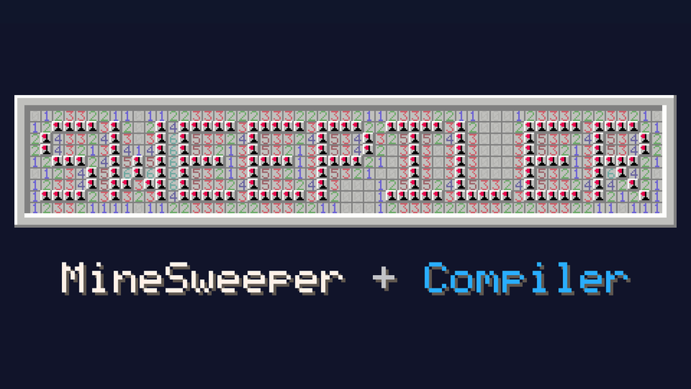
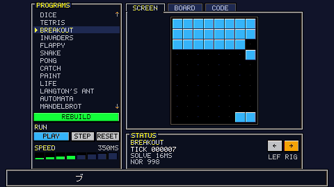
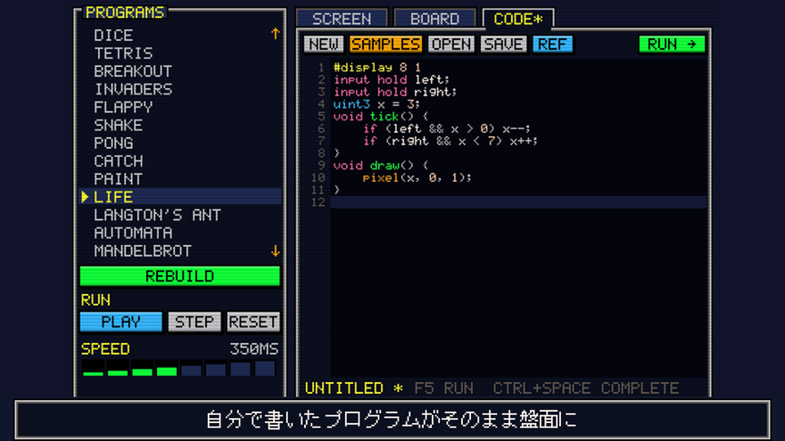
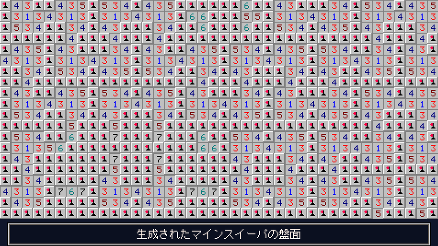
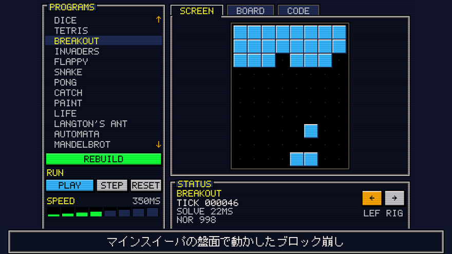
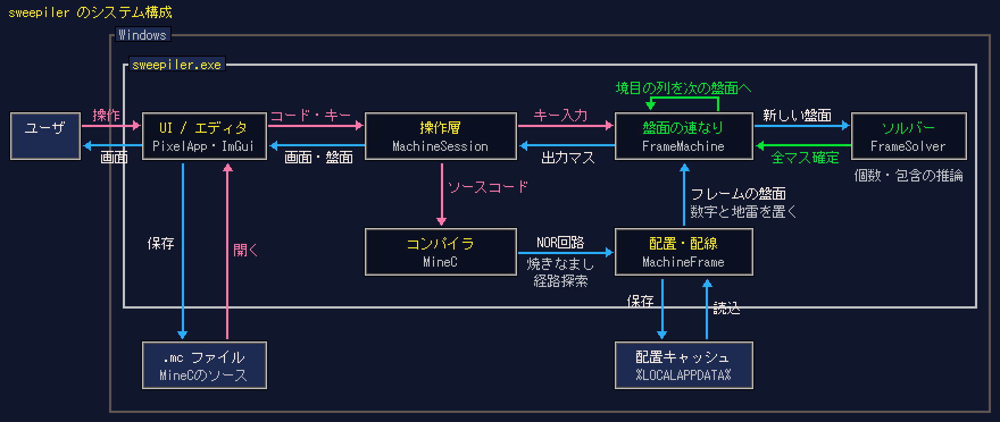

# sweepiler



**MineSweeper + Compiler。** 自分で書いたプログラムを、ふつうのマインスイーパの盤面に変換して動かします。

使うのは、0〜8の数字と地雷だけです。特別な記号やルールは足していません。盤面を解くと、その答えとしてテトリスやブロック崩しが動きます。



## どういうもの？

マインスイーパの数字をうまく並べると、論理回路（NORゲート）が作れることが知られています。sweepilerは、それを使ってプログラムを盤面にする「コンパイラ」です。

1. C風の言語MineCで、ゲームを書きます。
2. コンパイラが、それをNORゲートだけの回路にします。
3. 回路を配置・配線して、数字と地雷の盤面にします。
4. キー入力を入力マスの地雷にして、盤面を解きます。解き方は、人が使う「個数」と「包含」の推論だけです。全マスが一つに決まった盤面しか受け入れません。
5. 出力マスが地雷かどうかが、画面の画素になります。

1ティックが1枚の盤面です。盤面どうしは境目の列を共有していて、そこで状態が次のティックへ渡ります。キーを押すたびに新しい盤面が後ろにつながり、順番に解かれていきます。

| コードを書く | 盤面になる | ゲームが動く |
| --- | --- | --- |
|  |  |  |
| エディタでMineCを書き、F5で実行 | テトリスの盤面の一部（約2000万マスのうち） | 盤面を解いた答えで動くブロック崩し |

サンプルは19本あります（入門用の6本、テトリス、ブロック崩し、スネーク、ポン、ライフゲーム、マンデルブロ集合など）。

## MineCの例

矢印キーで点を動かすプログラムです。これが54個のNORゲートの回路になり、盤面になります。

```c
#display 8 8
input hold left;
input hold right;
input hold up;
input hold down;

uint3 x = 3;
uint3 y = 3;

void tick() {
    if (left && x > 0) x--;
    if (right && x < 7) x++;
    if (up && y > 0) y--;
    if (down && y < 7) y++;
}

void draw() {
    pixel(x, y, 1);
}
```

## システム構成



1. 利用者がエディタでMineCのコードを書き、`.mc`ファイルに保存
2. コンパイラでコードをNORゲートだけの回路に変換
3. 焼きなまし法と経路探索で回路を配置・配線し、数字と地雷の盤面を生成
4. 生成した盤面を配置キャッシュに保存し、2回目からは読み込むだけに
5. キー入力を入力マスの地雷にして、新しい盤面を前の盤面につなげる
6. ソルバーで個数と包含のふつうの推論だけを使って全マスを確定
7. 出力マスを画面の画素として、ImGuiで盤面と画面を表示

部品の回路（NOR、交差、配線など）は、正しい出力でSAT、誤った出力でUNSATになることをZ3で確かめています。ゲームは、同じ言語を整数で実行する参照インタプリタと、テストで1ティックずつ照合しています（参照インタプリタは確認専用で、ゲームの進行には使いません）。

## ビルドと起動

Windows 10/11 x64向けです。Visual Studio 2022以降の「C++によるデスクトップ開発」、Windows SDK、CMake 3.24以降、Gitが必要です。Developer PowerShellで、このフォルダから実行します。

```powershell
cmake -S . -B build -G "Visual Studio 17 2022" -A x64
cmake --build build --config Release --parallel
.\build\Release\sweepiler.exe
```

- Visual Studio 2026では、ジェネレーターを`Visual Studio 18 2026`にします。
- 初回の構成で、Dear ImGui v1.91.9bとZ3 4.13.4（公式のMSVC x64版、SHA-256を検査）を取得します。
- `sweepiler.exe`は、同じフォルダにできる`libz3.dll`を使います。
- テストは`ctest --test-dir build -C Release --output-on-failure`で実行します。

大きなサンプル（テトリスなど）は、最初の構築で配置と配線に10〜30秒ほどかかります。結果は`%LOCALAPPDATA%\InfiniteMinesweeper\frames`に保存されるので、2回目からはすぐ始まります。

## 遊び方

1. 左のPROGRAMSからサンプルを選び、BUILDを押します。
2. PLAYで動きます。キーは矢印キーなど、画面下のSTATUSに出ているものです。
3. SCREENタブがゲームの画面、BOARDタブが実際のマインスイーパの盤面、CODEタブがエディタです。
4. CODEタブで書き換えて、F5で実行します。自分の`.mc`ファイルもOPENで開けます。

## もっと詳しく

- [docs/SWEEPILER.md](docs/SWEEPILER.md)：アプリの画面と操作、ファイル構成、テストの中身
- [docs/MINEC.md](docs/MINEC.md)：MineC言語の書き方、サンプル、盤面の大きさと構築時間
- [docs/MACHINES.md](docs/MACHINES.md)：もう1つの小さな言語`.imsg`と、盤面をティックごとにつなげるしくみ
- [docs/CLASSIC_KERNELS.md](docs/CLASSIC_KERNELS.md)：NOR・交差・配線などの部品の数字と座標

マインスイーパの盤面で論理回路が組めることは、Kaye（2000）がNP完全性の証明の中で示しました。sweepilerの小さな部品は、Thieme・Basten（2022）の構成を参考にしています。

## ライセンス

[MIT](LICENSE)です。外部ライブラリ（Dear ImGui、Z3）のライセンスは[THIRD_PARTY_NOTICES.md](THIRD_PARTY_NOTICES.md)にあります。
